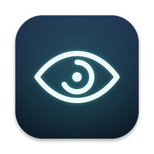

<p align="center">
  
</p>

<h1 align="center">Twenty</h1>

<p align="center">A tiny macOS menu bar app for the 20-20-20 rule.<br>
Every 20 minutes, look at something 20 feet away for 20 seconds.</p>

---

## Features

- **Gentle full-screen breaks.** A blurred overlay covers every display with a countdown ring. Press <kbd>Esc</kbd> to skip.
- **Heads-up before a break.** A small pill appears under the menu bar shortly before a break. It never takes focus or blocks clicks.
- **Holds breaks during calls.** If your camera or microphone is in use, the break waits until you're done. No permissions needed: Twenty only checks whether a device is busy and never reads audio or video.
- **Streaks.** Each break you finish adds one to your streak. Skipping a break resets it.
- **Smart reset.** After your screen wakes from sleep, the timer starts a fresh interval.
- **Lightweight.** Twenty is one Swift file with no dependencies and no Dock icon. It uses one-shot timers, so it does nothing between breaks.

## Requirements

- macOS 14 Sonoma or later
- Apple silicon (the build script targets `arm64`)
- Xcode Command Line Tools (`xcode-select --install`)

## Build and install

```sh
git clone https://github.com/<you>/twenty.git
cd twenty
./build.sh
```

The script compiles `Twenty.swift`, bundles it into `build/Twenty.app`, signs it ad hoc and **copies it to `/Applications`**, replacing any existing `Twenty.app` there. Launch it from Spotlight, then turn on **Open at login** in Settings if you'd like.

## Settings

Open the menu bar icon and choose **Settings…**

| Setting | Default | Range |
| --- | --- | --- |
| Break every | 20 min | 5–120 min |
| Break length | 20 sec | 10–300 sec |
| Heads-up | 1 minute before | Off, 15 s, 30 s, 1 min, 2 min |
| Chime when a break ends | On | |
| Hold breaks during calls | On | |
| Open at login | Off | |

## Testing

Any setting can be overridden from the command line, which helps when you don't want to wait 20 minutes:

```sh
build/Twenty.app/Contents/MacOS/Twenty -workMinutes 0.1 -breakSeconds 5 -warnSeconds 3
```

## Regenerating the icon

The app icon is drawn in code. To rebuild `AppIcon.icns` after editing `icon.swift`, run:

```sh
swift icon.swift
```

## License

[MIT](LICENSE)
